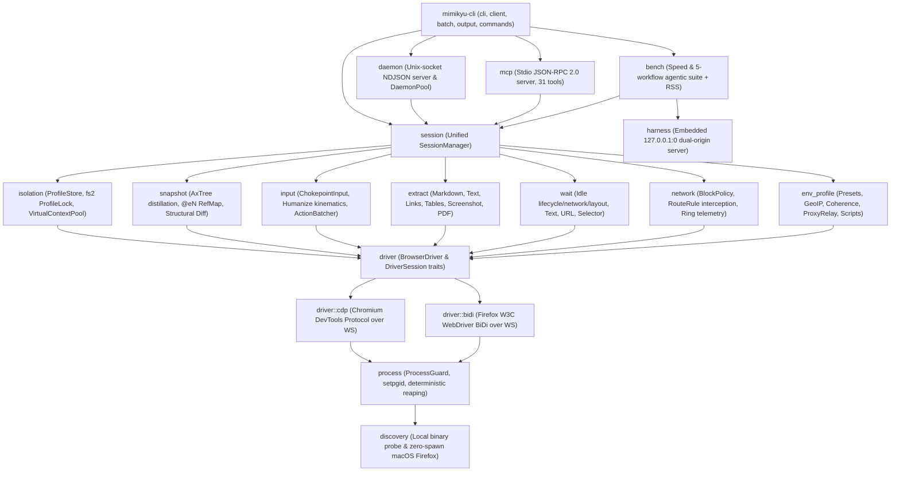

# Architecture & Scaling Invariants

`mimikyu` is a native Rust agentic browser runtime, two-tier isolation layer, and CLI / Daemon / MCP control plane driving local **Chromium (CDP)** and **Firefox (W3C WebDriver BiDi)** browsers.

This document maps the workspace dependency graph and codifies the **five non-negotiable invariants** that keep `mimikyu` fast, deterministic, and easy to review as external pull requests scale.

---

## Workspace & Module Topology

`mimikyu` is split into two Rust crates (`edition = "2024"`, MSRV `1.88`) and an opaque-box Python 3 stdlib end-to-end verification suite (`e2e/`):

- **`crates/mimikyu-core`**: Pure library crate containing browser discovery, process-group lifecycle, WebSocket CDP & BiDi protocol drivers, two-tier profile/context isolation, Camoufox-inspired environment profiles & `ProxyRelay`, semantic `@eN` accessibility snapshots, structured extraction, `ChokepointInput`, deterministic waits, the warm Unix-socket daemon, the 31-tool stdio MCP server, the dual-origin local HTTP test harness, and the benchmark suite.
- **`crates/mimikyu-cli`**: Thin binary crate (`mimikyu`) providing `clap` CLI argument parsing, `--json` envelope formatting, auto-spawning daemon client dispatch, and frontends for `mcp`, `daemon`, `doctor`, and `bench`.
- **`e2e/`**: Zero-dependency Python 3 stdlib test suite exercising the compiled `mimikyu` binary across local `127.0.0.1:0` HTTP/proxy servers (Tiers 1–4 + `--self-test`).

### Module Directory Reference

| Module Path | Responsibility |
| --- | --- |
| `crates/mimikyu-core/src/error.rs` | Typed `MimikyuError` & `Result<T>` error taxonomy across transport, protocol, timeout, and config faults |
| `crates/mimikyu-core/src/discovery.rs` | Local Chromium & Firefox discovery (`Override` -> `EnvOverride` -> Playwright/Puppeteer caches -> System/`PATH`) + `run_doctor()` |
| `crates/mimikyu-core/src/process.rs` | `ProcessGuard` launching debloated browsers in dedicated POSIX process groups (`setpgid(0, 0)`) with crash-dialog suppression |
| `crates/mimikyu-core/src/driver/mod.rs` | Engine-agnostic `BrowserDriver` & `DriverSession` traits, normalized `ProxyConfig`, protocol JSON surrogate sanitizer |
| `crates/mimikyu-core/src/driver/cdp.rs` | Native async WebSocket Chromium DevTools Protocol driver (isolated worlds, OOPIF/Shadow DOM traversal, network fetch routing) |
| `crates/mimikyu-core/src/driver/bidi.rs` | Native async WebSocket W3C WebDriver BiDi driver for Firefox/Gecko (user contexts, sandbox realms, network intercepts) |
| `crates/mimikyu-core/src/isolation/` | Tier-1 `ProfileStore` / `ProfileLock` (`fs2`) / `EphemeralDir` and Tier-2 `VirtualContextPool` + cookie/storage JSON import/export |
| `crates/mimikyu-core/src/env_profile/` | `win11` / `macos` / `linux` presets, coherence validator, offline GeoIP lookup, loopback `ProxyRelay`, window & worker init scripts |
| `crates/mimikyu-core/src/network/` | Resource blocking (`images`, `media`, `fonts`), glob/regex URL interception & mocking, bounded ring-buffer console/network logs |
| `crates/mimikyu-core/src/snapshot/` | Compact semantic accessibility tree builder, deterministic `@eN` `RefMap` locator resolution, and structural snapshot diffs |
| `crates/mimikyu-core/src/input/` | Per-session mutex-serialized `ChokepointInput`, viewport-clamped `humanize` trajectories/cadence, and atomic `ActionBatcher` |
| `crates/mimikyu-core/src/extract/` | Structured extraction (`markdown`, `text`, `links`, `tables`), viewport/full-page/element PNG screenshots, PDF, instant animations |
| `crates/mimikyu-core/src/wait/` | Composite `--idle` wait (DOM ready + network quiet + layout stability) plus `--text`, `--url`, and `--selector --state` polling |
| `crates/mimikyu-core/src/session.rs` | `SessionManager` unifying lifecycle, isolation modes, `@eN` state, `ChokepointInput`, `ProxyRelay`, and telemetry per session ID |
| `crates/mimikyu-core/src/daemon/` | Warm Unix-socket NDJSON RPC server (`DaemonServer`, `DaemonPool`), idle expiration, lock-safe auto-spawn, short-socket symlinking |
| `crates/mimikyu-core/src/mcp/` | Stateful stdio JSON-RPC 2.0 MCP server (`2024-11-05`) exposing 11 `mimikyu_*` and 20 `browser_*` tools |
| `crates/mimikyu-core/src/harness/` | Offline `127.0.0.1:0` primary + cross-origin HTTP test server powering integration tests and reproducible benchmarks |
| `crates/mimikyu-core/src/bench/` | Reproducible latency, token-compression, process-tree RSS, and 5-workflow agentic benchmark runner |
| `crates/mimikyu-cli/src/` | `clap` CLI definition (`cli.rs`), daemon auto-connect (`client.rs`), `--json` output envelope (`output.rs`), command handlers (`commands/`) |

---

## Non-Negotiable Architectural Invariants

Every pull request—whether authored by core maintainers, external contributors, or coding agents—is reviewed against these five invariants.

### Invariant 1: Strict `DriverSession` Dual-Engine Boundary (`driver/cdp.rs` + `driver/bidi.rs`)

- **Rule**: `BrowserDriver` and `DriverSession` (`crates/mimikyu-core/src/driver/mod.rs`) are the **only** boundary between wire protocols and higher-level subsystems.
- **No upward protocol leaks**: Raw CDP method names (`Page.*`, `DOM.*`, `Runtime.*`), BiDi realm/context internals (`browsingContext.*`, `script.*`), or engine-specific JSON shapes **must never** appear in `session.rs`, `snapshot/`, `input/`, `extract/`, `wait/`, `daemon/`, `mcp/`, or `crates/mimikyu-cli/`.
- **Parity or explicit capability gating**: New browser primitives must implement both `CdpDriver` and `BidiDriver` behind `DriverSession`, or explicitly declare support in `DriverCapabilities` and return `MimikyuError::Unsupported { engine, feature }` when an engine genuinely lacks a protocol capability.

### Invariant 2: `ChokepointInput` Single Input Serialization Boundary (`input/chokepoint.rs`)

- **Rule**: All user-simulating interactions—`click`, `fill`, `type`, `press`, `scroll`, `select`, `upload`, and multi-step `ActionBatcher` sequences (`input/batch.rs`)—**must** execute exclusively through `ChokepointInput`.
- **Why**: Concurrent MCP/daemon calls dispatching raw `dispatch_mouse`, `dispatch_key`, or `dispatch_wheel` events directly on `DriverSession` interleave modifier chords, corrupt humanized pointer trajectories, and hang on unacknowledged frames.
- **Guarantees enforced at the chokepoint**:
  1. Per-session `tokio::sync::Mutex` serialization so multi-event gestures (`move` -> `down` -> `up`, or `Ctrl+A` -> `Backspace` -> `insert_text`) are atomic.
  2. Bounded per-step ACK timeouts (`DEFAULT_INPUT_ACK_TIMEOUT_MS = 5_000`).
  3. Viewport-clamped coordinates (`clamp_point_to_viewport`, accounting for scrollbar gutters) so out-of-bounds clicks never silently drop.

### Invariant 3: Two-Tier Isolation & Zero-Orphan Process Groups (`isolation/`, `process.rs`)

- **Rule**: Every browser process is owned by a `ProcessGuard` (`crates/mimikyu-core/src/process.rs`) placed into its own POSIX process group (`libc::setpgid(0, 0)` inside `pre_exec`) before `exec`.
- **Deterministic teardown**: Shutdown always executes in order:
  1. Graceful protocol close (`Browser.close` on CDP / `browser.close` on BiDi) within a bounded grace window.
  2. Process-group `SIGTERM` (`kill(-pgid, SIGTERM)`).
  3. Process-group `SIGKILL` (`kill(-pgid, SIGKILL)`) + `wait_for_pgid_gone`, followed by releasing `ProfileLock` (`fs2`) and deleting any `EphemeralDir`.
- **Test requirement**: Every test binary and E2E run must finish with **zero orphan `mimikyu`, Chromium, or Firefox helper processes** and **zero leaked `/tmp` profile directories**, including on error or panic paths (`Drop`).

### Invariant 4: macOS Zero-Spawn Firefox Probe & Crash-Reporter Suppression (`discovery.rs`, `process.rs`)

- **Rule**: On macOS `.app` bundles, Firefox version discovery (`crates/mimikyu-core/src/discovery.rs`) **must** read `Contents/Resources/application.ini` and `Contents/Info.plist` directly from disk rather than spawning `firefox --version` repeatedly.
- **Why**: Cold-spawning `firefox --version` on macOS exits in ~50 ms while Firefox's background `RegisterFonts` thread is still initializing, triggering a race inside `__cxa_finalize_ranges` (`SIGSEGV`) and popping macOS `CrashReporter` dialogs on the user's desktop.
- **Companion rules**:
  - Every Firefox process spawn or fallback probe **must** set `MOZ_CRASHREPORTER_DISABLE=1`, `MOZ_CRASHREPORTER=0`, and `MOZ_CRASHREPORTER_NO_REPORT=1`.
  - Chromium version probes **must** pass `--version` only—never `--help` (which hangs `chrome-headless-shell` indefinitely).

### Invariant 5: Narrow Vertical PR Slices & Three-Tier Offline Verification

- **Narrow PR scope (2–3 modules max)**: Keep each PR focused on a single vertical slice or bug fix touching at most **2–3 modules** (plus its dedicated tests). Split trait additions, refactors, and unrelated CLI polish into separate PRs so reviews stay fast and conflict-free.
- **100% offline loopback testing (`127.0.0.1:0`)**: Automated unit, integration, benchmark, and E2E tests **must never** make live requests to external internet domains (`example.com`, `google.com`, etc.). Use `crates/mimikyu-core/src/harness/` in Rust tests and `e2e/local_server.py` in Python E2E tests.
- **Required verification tiers**:
  1. **Lint & Format**: `cargo fmt --all -- --check` and `cargo clippy --workspace --all-targets -- -D warnings` (0 warnings).
  2. **Rust Workspace Tests**: `cargo test --workspace` (unit + live local harness integration + CLI contract tests).
  3. **Opaque-Box E2E Parity**:
     - `python3 e2e/run_e2e.py --self-test`
     - `python3 e2e/run_e2e.py --tier all --bin ./target/release/mimikyu`
     - `python3 e2e/run_e2e.py --tier 4 --engine firefox --bin ./target/release/mimikyu`

---

## Security & R3 Scope Invariant

Across all modules and tests:

- **Default isolated world**: `eval` executes in an isolated world unless `--main-world` (`EvalOptions { main_world: true, .. }`) is explicitly requested.
- **Redacted proxy credentials**: Authenticated proxies always route through `ProxyRelay` on `127.0.0.1:0`.
- **Strict R3 exclusion**: `mimikyu` never implements, bundles, or tests CAPTCHA solvers, human-verification challenge bypasses, or proof-of-work crackers. See [SECURITY.md](./SECURITY.md) for full details.
