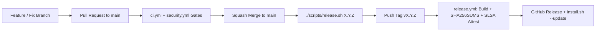

# Release & Version Control Process

This document defines the official Semantic Versioning, trunk-based branching, automated build/attestation pipeline, and user self-update lifecycle for `mimikyu`.

---

## 1. Versioning Policy (SemVer 2.0.0)

`mimikyu` follows [Semantic Versioning 2.0.0](https://semver.org/spec/v2.0.0.html) (`MAJOR.MINOR.PATCH`) synchronized across the Cargo workspace:

- **`Cargo.toml`** (`[workspace.package].version`) is the single source of truth inherited by both `crates/mimikyu-core` and `crates/mimikyu-cli`.
- **`Cargo.lock`**, **`packaging/homebrew/mimikyu.rb`**, and **`CHANGELOG.md`** are kept strictly synchronized and verified in CI by `./scripts/check-version-sync.sh`.
- **Pre-`1.0` (`0.y.z`) rules**:
  - `0.MINOR.0` — New features, new MCP tools, CLI flag additions, or intentional minor contract evolutions documented in `CHANGELOG.md`.
  - `0.y.PATCH` — Backwards-compatible bug fixes, driver protocol resilience improvements, security fixes, and performance optimizations.
- **`1.0.0+` rules**:
  - `MAJOR` — Breaking CLI `--json` envelope changes, removed CLI flags/subcommands, breaking MCP tool input schemas, or public `mimikyu-core` API breaks.
  - `MINOR` — Backwards-compatible CLI/MCP/library additions.
  - `PATCH` — Backwards-compatible bug and security fixes.

---

## 2. Trunk-Based Branching & PR Flow



1. **`main` is always releasable**: All development happens on short-lived topic branches (`feat/<topic>`, `fix/<topic>`, `docs/<topic>`, `chore/<topic>`) targeting `main`.
2. **Conventional Commits & Changelog**:
   - PR titles and squash-merge commits use Conventional Commits (`feat:`, `fix:`, `perf:`, `docs:`, `test:`, `chore:`).
   - User-visible additions, fixes, or security changes add an entry under `## [Unreleased]` in [CHANGELOG.md](./CHANGELOG.md).
3. **Automated PR Gates**:
   - [`.github/workflows/ci.yml`](./.github/workflows/ci.yml): Version sync, POSIX shell lint, path/secret hygiene, `cargo clippy --workspace --all-targets -- -D warnings`, workspace unit & integration tests (Linux + macOS), Python E2E `--self-test` + Chromium/Firefox E2E suites, and `install.sh --from-source` smoke tests.
   - [`.github/workflows/security.yml`](./.github/workflows/security.yml): `cargo-deny` license/source/ban checks and `cargo-audit` RustSec vulnerability scanning.

---

## 3. Cutting a Production Release (`scripts/release.sh`)

Never manually edit version numbers across scattered files or push unverified tags. Always use `./scripts/release.sh` from a clean `main` checkout.

### Step 1: Sync `main` & Run Local Pre-Flight Checks

```sh
git checkout main
git pull --ff-only origin main

# Verify workspace lints, unit/integration tests, and version sync
cargo clippy --workspace --all-targets -- -D warnings
cargo test --workspace
python3 e2e/run_e2e.py --self-test
./scripts/check-version-sync.sh
```

### Step 2: Review `CHANGELOG.md` & Run a Dry-Run Simulation

Confirm `## [Unreleased]` in `CHANGELOG.md` summarizes all changes since the previous tag, then preview the release without modifying the working tree:

```sh
./scripts/release.sh --dry-run 0.1.1
```

`--dry-run` stages the manifest, lockfile, Homebrew formula, and changelog updates in a temporary directory, runs `./scripts/check-version-sync.sh --tag v0.1.1` against the simulated files, and prints every planned command while leaving your working tree untouched.

### Step 3: Cut the Release Commit & Annotated Tag

```sh
# Creates commit `chore(release): v0.1.1` and annotated tag `v0.1.1` locally
# Pass `--sign` to force GPG/SSH tag signing (`git tag -s`)
./scripts/release.sh 0.1.1
```

What `./scripts/release.sh` executes deterministically:
1. Confirms the current branch is `main`, the git working tree is clean, and tag `vX.Y.Z` does not already exist.
2. Updates `[workspace.package] version = "X.Y.Z"` in `Cargo.toml` and `version "X.Y.Z"` in `packaging/homebrew/mimikyu.rb`.
3. Runs `cargo check --workspace` so `Cargo.lock` updates cleanly.
4. Stamps `CHANGELOG.md` (`## [Unreleased]` followed by `## [X.Y.Z] - YYYY-MM-DD`).
5. Verifies full consistency via `./scripts/check-version-sync.sh --tag vX.Y.Z`.
6. Commits `chore(release): vX.Y.Z` and creates annotated git tag `vX.Y.Z`.

### Step 4: Inspect & Push to Trigger Production `release.yml`

By default, `./scripts/release.sh` **never pushes automatically** so maintainers can inspect the commit and tag first:

```sh
git show v0.1.1
git push origin main
git push origin v0.1.1
```

*(Alternatively, pass `--push` directly: `./scripts/release.sh --sign --push 0.1.1`.)*

---

## 4. Automated Production Pipeline (`.github/workflows/release.yml`)

Pushing a `v*.*.*` tag triggers [`.github/workflows/release.yml`](./.github/workflows/release.yml) across three gated stages:

1. **`verify` Gate**:
   - Executes `./scripts/check-version-sync.sh --tag ${{ github.ref_name }}` (blocking publication if tag, `Cargo.toml`, `Cargo.lock`, Homebrew formula, or `CHANGELOG.md` are out of sync).
   - Runs `cargo clippy --workspace --all-targets -- -D warnings`, `cargo test --workspace --locked`, and `python3 e2e/run_e2e.py --self-test`.
2. **`build` Matrix**:
   - Compiles `--release --locked` `mimikyu` binaries and packages `mimikyu-<target>.tar.gz` archives for:
     - `aarch64-apple-darwin` (macOS Apple Silicon)
     - `x86_64-apple-darwin` (macOS Intel)
     - `x86_64-unknown-linux-gnu` (Linux x86_64)
     - `aarch64-unknown-linux-gnu` (Linux ARM64)
3. **`publish` & Provenance Attestation**:
   - Computes `SHA256SUMS` across all 4 tarballs.
   - Renders a release-ready `mimikyu.rb` Homebrew formula populated with `${{ github.repository }}`, the release version, and the exact SHA-256 digests.
   - Signs SLSA build provenance for `mimikyu-*.tar.gz` and `SHA256SUMS` using [`actions/attest-build-provenance@v2`](https://github.com/actions/attest-build-provenance).
   - Extracts the stamped `## [X.Y.Z]` release notes from `CHANGELOG.md` and publishes the GitHub Release (automatically marking `-alpha`, `-beta`, or `-rc` tags as pre-releases).

---

## 5. User Installation, Verification & Update Lifecycle

Once `release.yml` publishes `vX.Y.Z`, users upgrade safely across supported channels:

### POSIX CLI Self-Updater (`install.sh`)

```sh
# Atomically upgrade if a newer GitHub Release tag is available
curl -fsSL https://raw.githubusercontent.com/YXZYSME/mimikyu/main/install.sh | sh -s -- --update

# Pin a specific version and verify both SHA-256 + GitHub SLSA Artifact Attestation
curl -fsSL https://raw.githubusercontent.com/YXZYSME/mimikyu/main/install.sh | \
  sh -s -- --version v0.1.1 --verify-attestation
```

Security guarantees enforced by `install.sh`:
- Downloads both `mimikyu-<target>.tar.gz` and `SHA256SUMS` into a private temporary directory (`mktemp -d`).
- **Verifies the 64-character SHA-256 digest before extracting** (`shasum -a 256` / `sha256sum`), aborting immediately on any mismatch.
- Optionally verifies cryptographic SLSA provenance via `gh attestation verify --repo YXZYSME/mimikyu` when `--verify-attestation` is passed.
- Stages the binary in the destination directory and swaps it into place via atomic POSIX `mv`.

### Homebrew Tap (`packaging/homebrew/mimikyu.rb`)

Copy the rendered `mimikyu.rb` asset attached to the GitHub Release into `Formula/mimikyu.rb` in your `homebrew-tap` repository (`YXZYSME/homebrew-tap`), allowing users to run:

```sh
brew update && brew upgrade mimikyu
```

### Cargo & `cargo-binstall`

```sh
# Prebuilt binary via [package.metadata.binstall]
cargo binstall mimikyu-cli

# Build from tagged git source
cargo install --locked --git https://github.com/YXZYSME/mimikyu --tag v0.1.1 mimikyu-cli
```

---

## 6. Hotfixes & Failed Release Recovery

- **If `release.yml` fails before publishing a GitHub Release**:
  Fix the issue via a normal PR to `main` and cut the next patch version (`X.Y.(Z+1)`). Avoid deleting and force-repushing public `vX.Y.Z` tags once pushed, as downstream caches and checksum verifiers treat release tags as immutable.
- **If a critical regression or vulnerability is discovered in `vX.Y.Z`**:
  1. Mark the affected GitHub Release as pre-release or add an advisory banner pointing to the patch version (never silently overwrite release tarballs).
  2. Land the fix on `main` and immediately cut `vX.Y.(Z+1)` via `./scripts/release.sh` so `install.sh --update` upgrades users atomically.
