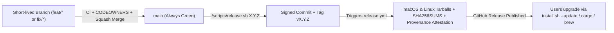

# Open-Source Launch & Repository Operations Guide

This runbook provides the repository owner and maintainers with concrete, copy-pasteable procedures for launching `mimikyu` publicly on GitHub, hardening repository security, scaling external pull requests without breaking `main` or blowing up CI runner budgets, and executing deterministic production releases.

---

## 1. Pre-Launch Checklist & `gh repo create` Procedure

### Step 1.1: Verify Repository Owner & Metadata Configuration

All repository metadata, governance rules, and packaging manifests are wired to [`YXZYSME/mimikyu`](https://github.com/YXZYSME/mimikyu):

1. **`.github/CODEOWNERS`**: Default and critical-subsystem ownership configured for `@YXZYSME`.
2. **`.github/ISSUE_TEMPLATE/config.yml`**: Security advisory and Discussions links point to `https://github.com/YXZYSME/mimikyu/...`.
3. **`Cargo.toml`, `crates/*/Cargo.toml`, `install.sh`, `packaging/homebrew/mimikyu.rb`, `packaging/npm/*/package.json`, `packaging/pypi/pyproject.toml`, `server.json`, `CITATION.cff`, `README.md`, `CONTRIBUTING.md`, `RELEASE.md`, `SECURITY.md`, `CHANGELOG.md`**: Configured for `https://github.com/YXZYSME/mimikyu`.

Verify zero local machine paths, personal usernames, or secrets exist anywhere in tracked history or working tree:

```bash
git status
./install.sh --dry-run
./scripts/check-version-sync.sh --tag v0.2.0
cargo clippy --workspace --all-targets -- -D warnings
cargo test --workspace
```

### Step 1.2: Create & Configure the Public GitHub Repository via `gh`

Authenticate with `gh auth status`, then create the repository, set discovery topics, enable Discussions, and disable unused legacy surfaces (Wikis/Projects):

```bash
OWNER="YXZYSME"

# 1. Create public repository from local checkout and push `main`
gh repo create "${OWNER}/mimikyu" \
  --public \
  --source=. \
  --remote=origin \
  --description "High-speed Rust agentic browser runtime, two-tier isolation layer, and CLI / Daemon / MCP toolkit for Chromium (CDP) & Firefox (WebDriver BiDi)" \
  --push

# 2. Configure repository features & merge policy (Squash-only + auto-delete branches)
gh repo edit "${OWNER}/mimikyu" \
  --enable-issues \
  --enable-discussions \
  --enable-wiki=false \
  --enable-projects=false \
  --enable-squash-merge \
  --enable-merge-commit=false \
  --enable-rebase-merge=false \
  --delete-branch-on-merge

# 3. Add discoverability topics
gh repo edit "${OWNER}/mimikyu" \
  --add-topic rust \
  --add-topic browser-automation \
  --add-topic mcp \
  --add-topic mcp-server \
  --add-topic ai-agents \
  --add-topic cdp \
  --add-topic webdriver-bidi \
  --add-topic chromium \
  --add-topic firefox \
  --add-topic cli
```

---

## 2. GitHub Rulesets & Branch / Tag Protection (`main` + `v*`)

Prefer **GitHub Repository Rulesets** (**Settings -> Rules -> Rulesets**) over legacy branch protection rules—Rulesets version cleanly via JSON, protect both `main` and `v*` release tags, and support linear history + signed commits uniformly.

### 2.1 `main` Branch Ruleset Settings

Configure a branch ruleset named **`protect-main`** targeting the **Default branch (`main`)** with **Enforcement status: Active**:

| Setting | Recommended Value | Why |
| --- | --- | --- |
| **Restrict deletions** | Enabled | Prevents accidental deletion of `main` |
| **Block force pushes** | Enabled | Preserves immutable commit history and release provenance |
| **Require linear history** | Enabled | Enforces clean single-commit Squash merges (`feat(...)`, `fix(...)`) |
| **Require signed commits** | Enabled | Verifies cryptographic author identity (SSH or GPG commit signing) |
| **Require a pull request before merging** | Enabled (`>= 1` approval) | All changes pass PR review and automated checks |
| **Require review from Code Owners** | Enabled | Enforces `.github/CODEOWNERS` sign-off on drivers, security, and CI |
| **Dismiss stale PR approvals when new commits are pushed** | Enabled | Prevents unreviewed post-approval commits from landing |
| **Require conversation resolution before merging** | Enabled | Ensures every review comment is addressed or resolved |
| **Allowed merge methods** | **Squash only** | Keeps `git log --oneline` 1:1 with PRs and Conventional Commits |
| **Require status checks to pass** | Enabled (+ strict up-to-date check) | Blocks merge until all required jobs in `ci.yml` and `security.yml` pass |

> **Solo-maintainer tip**: While you are the sole maintainer, add **Repository admin** to the Ruleset **Bypass list** with mode **"Pull requests only"** (or require `0` extra human approvals while keeping **Require status checks to pass**, **Linear history**, **Signed commits**, and **Block force pushes** active) so you never deadlock your own PRs, then raise `required_approving_review_count` to `1` as soon as a second maintainer joins `.github/CODEOWNERS`.

#### Apply `protect-main` via `gh api`

Once your first CI run on `main` has registered the exact check job names from `.github/workflows/ci.yml` and `.github/workflows/security.yml`, inspect check names with `gh pr checks` or `gh run view`, then create the ruleset:

```bash
gh api --method POST "repos/${OWNER}/mimikyu/rulesets" --input - <<'EOF'
{
  "name": "protect-main",
  "target": "branch",
  "enforcement": "active",
  "conditions": {
    "ref_name": {
      "include": ["~DEFAULT_BRANCH"],
      "exclude": []
    }
  },
  "rules": [
    { "type": "deletion" },
    { "type": "non_fast_forward" },
    { "type": "required_linear_history" },
    { "type": "required_signatures" },
    {
      "type": "pull_request",
      "parameters": {
        "required_approving_review_count": 1,
        "dismiss_stale_reviews_on_push": true,
        "require_code_owner_review": true,
        "require_last_push_approval": false,
        "required_review_thread_resolution": true,
        "allowed_merge_methods": ["squash"]
      }
    }
  ]
}
EOF
```

Then attach your exact required status checks in **Settings -> Rules -> Rulesets -> `protect-main` -> Require status checks to pass** (from `.github/workflows/ci.yml` and `.github/workflows/security.yml`):

- `Hygiene, Shell Syntax & Version Sync`
- `Rust Clippy & Tests (ubuntu-latest)`
- `Rust Clippy & Tests (macos-latest)`
- `Python E2E (self-test)`
- `Python E2E (chromium-tiers-1-4)`
- `Python E2E (firefox-tier-4)`
- `Installer Smoke Test (ubuntu-latest)`
- `Installer Smoke Test (macos-latest)`
- `cargo-deny (Licenses, Advisories, Bans & Sources)`
- `cargo-audit (RustSec Advisory Database)`

### 2.2 Release Tag Ruleset (`protect-release-tags`)

Because `.github/workflows/release.yml` builds and attests production binaries whenever `v*.*.*` tags are pushed, **protect `refs/tags/v*`** so tags can never be deleted, moved, or created by non-maintainers:

```bash
gh api --method POST "repos/${OWNER}/mimikyu/rulesets" --input - <<'EOF'
{
  "name": "protect-release-tags",
  "target": "tag",
  "enforcement": "active",
  "bypass_actors": [
    {
      "actor_id": 5,
      "actor_type": "RepositoryRole",
      "bypass_mode": "always"
    }
  ],
  "conditions": {
    "ref_name": {
      "include": ["refs/tags/v*"],
      "exclude": []
    }
  },
  "rules": [
    { "type": "creation" },
    { "type": "update" },
    { "type": "deletion" },
    { "type": "non_fast_forward" }
  ]
}
EOF
```
*(Role ID `5` corresponds to Repository Admin, allowing only repository admins to push new `v*` tags while permanently blocking tag mutation or deletion.)*

---

## 3. GitHub Security & Actions Hardening

Enable all native GitHub security features immediately after `gh repo create`:

### 3.1 Private Vulnerability Reporting, Dependabot & Secret Scanning

```bash
# 1. Enable GitHub Private Vulnerability Reporting (powers SECURITY.md workflow)
gh api --method PUT "repos/${OWNER}/mimikyu/private-vulnerability-reporting"

# 2. Enable Dependabot vulnerability alerts & automated security fix PRs
gh api --method PUT "repos/${OWNER}/mimikyu/vulnerability-alerts"
gh api --method PUT "repos/${OWNER}/mimikyu/automated-security-fixes"

# 3. Enable Secret Scanning & Secret Scanning Push Protection
gh api --method PATCH "repos/${OWNER}/mimikyu" \
  -f 'security_and_analysis[secret_scanning][status]=enabled' \
  -f 'security_and_analysis[secret_scanning_push_protection][status]=enabled'
```

### 3.2 GitHub Actions Least-Privilege Policy

In **Settings -> Actions -> General**:

1. **Workflow permissions**:
   - Select **"Read repository contents and packages permissions"** (`contents: read` default).
   - **Uncheck** *"Allow GitHub Actions to create and approve pull requests"*.
   - Confirm via CLI:
     ```bash
     gh api --method PUT "repos/${OWNER}/mimikyu/actions/permissions/workflow" \
       -f default_workflow_permissions=read \
       -F can_approve_pull_request_reviews=false
     ```
2. **Fork pull request workflows from outside collaborators**:
   - Select **"Require approval for all external contributors"** (or at minimum **"Require approval for first-time contributors"**). This gives maintainers a 30-second visual sanity check on workflow/Cargo.toml changes before burning macOS/Linux browser CI minutes on unknown forks.
3. **Action pinning & supply-chain checks**:
   - Keep third-party actions pinned to immutable commit SHAs (or major tags audited by `.github/dependabot.yml` weekly `github-actions` updates).
   - Keep `.github/workflows/security.yml` (`cargo deny check` against `deny.toml` + `rustsec/advisory-db`) required on every PR touching `Cargo.toml` or `Cargo.lock`.

---

## 4. Scaling External Pull Requests Safely

As community stars, issues, and external PRs grow, three failure modes kill open-source browser projects: **unsafe fork CI triggers**, **sprawling multi-thousand-line PRs**, and **flaky internet-dependent browser tests**. Here is how `mimikyu` prevents all three:

### 4.1 Workflow Trigger Safety (`pull_request` Only — Never Unsafe `pull_request_target`)

> [!CAUTION]
> **NEVER** add a workflow triggered by `pull_request_target` that checks out (`actions/checkout` with `ref: ${{ github.event.pull_request.head.sha }}`), compiles (`cargo build` / `build.rs` proc-macros), or executes untrusted fork code (`python3 e2e/run_e2e.py`). `pull_request_target` runs in the context of `main` with write-capable `GITHUB_TOKEN` and repository secrets.

- Always use standard `on: pull_request` with `permissions: contents: read` for CI verification.
- Keep release signing and attestation (`contents: write`, `id-token: write`, `attestations: write`) strictly isolated inside `.github/workflows/release.yml` triggered solely on protected `v*.*.*` tags.

### 4.2 Two-Stage / Label-Gated Browser Matrix

Headless Chromium + Firefox E2E matrices (especially on `macos-latest` runners, which bill at 10x Linux runner multipliers on private repos and throttle concurrency on public repos) should stay fast and staged:

1. **Stage 1 — Fast Gate (~60–90s on Ubuntu)**:
   - `cargo fmt --all -- --check`
   - `cargo clippy --workspace --all-targets -- -D warnings`
   - `cargo test --workspace --lib` + `cargo test -p mimikyu-cli`
   - `python3 e2e/run_e2e.py --self-test` + path/secret/R3 hygiene check.
2. **Stage 2 — Live Browser Matrix (`needs: [fast-gate]`)**:
   - Only spins up Chromium CDP + Firefox WebDriver BiDi E2E runners after Stage 1 passes.
   - **High-volume scaling knob**: If external PR traffic grows past 20+ PRs/day, gate the macOS E2E leg behind `if: github.event_name == 'push' || contains(github.event.pull_request.labels.*.name, 'run-macos-e2e')` while running Linux Chromium + Firefox E2E on every approved PR, and full macOS + Linux E2E on every merge to `main` and every `v*` release tag.

### 4.3 Keeping PR Review Time Under 10 Minutes

Enforce the invariants documented in [ARCHITECTURE.md](../ARCHITECTURE.md) and `.github/PULL_REQUEST_TEMPLATE.md`:

- **2–3 Module Vertical Slice Cap**: Politely ask authors of 15-file mega-PRs to split trait plumbing (`driver/mod.rs`) from CLI/MCP wiring.
- **100% Offline Loopback Tests (`127.0.0.1:0`)**: Reject any test hitting live external websites—every regression fix belongs in `crates/mimikyu-core/src/harness/` or `e2e/local_server.py`.
- **Immediate R3 Triage**: Close any issue or PR requesting CAPTCHA solvers, human-verification bypasses, or anti-bot gate circumvention using a standard saved reply pointing to `SECURITY.md#strict-r3-scope--abuse-boundary-out-of-scope`.

### 4.4 Contributor Ladder

Scale maintainer bandwidth gradually without handing out broad admin permissions prematurely:

1. **Community Reporter / User**: Files reproducible `[Bug]` / `[Feat]` issues with `mimikyu doctor --json` diagnostics and helps others in GitHub Discussions.
2. **Contributor**: Lands 1+ narrow, well-tested PRs following Conventional Commits.
3. **Triager (`Triage` repository role — zero code write access)**: Trusted contributors who have helped reproduce bugs across engines. Can apply labels (`bug`, `engine:bidi`, `engine:cdp`, `out-of-scope:r3`), close duplicate/out-of-scope issues, and request reproduction steps.
4. **Area Reviewer (`Write` role, scoped via `.github/CODEOWNERS`)**: Sustained contributors owning a specific subsystem (e.g., `/crates/mimikyu-core/src/extract/`, `/packaging/`, `/e2e/`) while `CODEOWNERS` still requires Core Maintainer review on `/crates/mimikyu-core/src/driver/`, `/daemon/`, `/SECURITY.md`, and `/.github/`.
5. **Core Maintainer (`Maintain` role)**: Trusted stewards able to approve cross-cutting `DriverSession` changes and run release dry-runs.

---

## 5. Official Version Control & Production Release Cadence

`mimikyu` follows strict **Semantic Versioning (`SemVer 2.0.0`)** and **Trunk-Based Development** on `main` (see `RELEASE.md` for detailed script reference).



### 5.1 Versioning Policy (`0.y.z` -> `1.0.0`)

- **While `0.y.z` (`0.2.x`, `0.3.x`)**:
  - **Patch (`0.2.1`)**: Bug fixes, engine compatibility fixes, performance wins, dependency security updates, and additive non-breaking flags.
  - **Minor (`0.3.0`)**: Major new subsystems, MCP protocol version bumps, or breaking changes to `--json` envelopes / `mimikyu-core` Rust traits (clearly called out under `### Changed` / `### Breaking` in `CHANGELOG.md`).

### 5.2 Step-by-Step Production Release Procedure

1. **Ensure `main` is clean, synced, and green**:
   ```bash
   git checkout main
   git pull --ff-only origin main
   ```
2. **Dry-run the release script first** (verifies clean working tree, SemVer validity, version sync, and `CHANGELOG.md` formatting without mutating git history):
   ```bash
   ./scripts/release.sh --dry-run 0.2.1
   ```
3. **Cut the release commit and tag**:
   ```bash
   ./scripts/release.sh 0.2.1
   ```
   Under the hood, `scripts/release.sh`:
   - Updates `[workspace.package] version = "0.2.1"` in `Cargo.toml` and syncs `Cargo.lock`, `packaging/homebrew/mimikyu.rb`, `packaging/npm/{mimikyu-mcp,saengil-mimikyu,mimikyu-cli}/package.json`, `packaging/pypi/pyproject.toml`, `packaging/pypi/src/mimikyu_pypi/__init__.py`, `server.json`, and `CITATION.cff`,
   - Stamps `CHANGELOG.md` (`[Unreleased]` -> `[0.2.1] - YYYY-MM-DD`),
   - Verifies lockstep consistency via `./scripts/check-version-sync.sh --tag v0.2.1`,
   - Creates `chore(release): v0.2.1` and annotated tag `v0.2.1`.
4. **Land on `main` and push tag to trigger `.github/workflows/release.yml`**:
   - *If maintainer admin bypass is enabled for release commits*:
     ```bash
     git push origin main
     git push origin v0.2.1
     ```
   - *If `protect-main` strictly requires PRs even for admins*: push the `chore(release): v0.2.1` commit on a `release/v0.2.1` branch, squash-merge the PR to `main`, pull `main`, tag the merged commit `git tag -s v0.2.1 -m "Release v0.2.1"`, and run `git push origin v0.2.1`.
5. **Verify automated release artifacts & multi-registry OIDC publication**:
   - Watch `.github/workflows/release.yml` via `gh run watch`.
   - Confirm `GitHub Release v0.2.1` contains:
     - `mimikyu-aarch64-apple-darwin.tar.gz`
     - `mimikyu-x86_64-apple-darwin.tar.gz`
     - `mimikyu-x86_64-unknown-linux-gnu.tar.gz`
     - `mimikyu-aarch64-unknown-linux-gnu.tar.gz`
     - `SHA256SUMS` & rendered `mimikyu.rb`
     - Signed GitHub build provenance attestation (`gh attestation verify mimikyu-*.tar.gz --repo "${OWNER}/mimikyu"`).
   - Confirm downstream OIDC jobs succeed:
     - `publish-crates`: `mimikyu-core`, `mimikyu-cli`, `mimikyu` live on `crates.io`.
     - `publish-mcp`: `mimikyu-mcp`, `saengil-mimikyu`, `mimikyu-cli` live on `npm` with provenance, and `server.json` published to the Official MCP Registry.
     - `publish-pypi`: `mimikyu` wheel & sdist live on `PyPI`.
     - Homebrew tap: `Formula/mimikyu.rb` pushed to `YXZYSME/homebrew-tap` (automatically when `HOMEBREW_TAP_TOKEN` is configured, or manually from the attached `mimikyu.rb` asset).

### 5.3 End-User Installation & Atomic Update Channels

Once `vX.Y.Z` is live on GitHub Releases, users upgrade seamlessly across all supported channels:

- **One-line POSIX install**:
  ```bash
  curl -fsSL https://raw.githubusercontent.com/YXZYSME/mimikyu/main/install.sh | sh
  ```
- **In-place verified atomic update** (compares `mimikyu --version` against latest release tag, verifies `SHA256SUMS`, and atomically swaps the binary):
  ```bash
  curl -fsSL https://raw.githubusercontent.com/YXZYSME/mimikyu/main/install.sh | sh -s -- --update
  ```
- **Attestation-verified / pinned CI install**:
  ```bash
  curl -fsSL https://raw.githubusercontent.com/YXZYSME/mimikyu/main/install.sh | sh -s -- --version v0.2.0 --verify-attestation
  ```
- **Cargo (`binstall` / `--git` / source)**:
  ```bash
  cargo binstall mimikyu-cli
  cargo install --git https://github.com/YXZYSME/mimikyu --tag v0.2.0 mimikyu-cli
  ```

---

## 6. Parody, Branding & Trademark Best Practices

`mimikyu` embraces playful 16-bit pixel-art aesthetics around its core metaphor of disguising a clean native Rust browser engine beneath a cozy environment-profile cloak. To keep the project legally clean, respectful, and unambiguous at scale:

1. **Explicit Non-Affiliation Notice**:
   - Always retain the prominent disclaimer in `README.md`:
     > *"`mimikyu` is an independent open-source software project; it is not affiliated with, endorsed by, or sponsored by Nintendo, Creatures Inc., GAME FREAK, or The Pokémon Company."*
2. **100% Original Artwork & Assets (`assets/`)**:
   - Every SVG banner, mascot icon, and pixel divider in `assets/` must remain **100% original pixel art** authored from scratch for this repository (an original stitched pixel browser-window / rag-fox sprite).
   - **Never** commit, trace, embed, or link official Pokémon sprites, ripped GBA/DS/3DS/Switch assets, official logos, Pokéball icons, or copyrighted game fonts/audio in code, docs, or PR comments.
3. **Clear Functional Domain & Non-Commercial OSS Posture**:
   - Keep repository descriptions, crates.io / Homebrew metadata, and social previews unambiguously focused on **developer browser automation, CLI/MCP tooling, and session isolation** (zero overlap with video games, ROM tools, or merchandise).
   - Never sell branded merchandise or commercial SaaS tiers under third-party character marks; distribute strictly under open-source `MIT OR Apache-2.0` licensing.
4. **Graceful Courtesy Policy**:
   - Because the CLI invokes a single binary name (`mimikyu`) and environment prefix (`MIMIKYU_*`) centralized in `crates/mimikyu-cli` and `discovery.rs`, if any trademark holder ever submits a polite rename request, cooperate promptly and amicably while providing a temporary compatibility symlink in `install.sh`.
